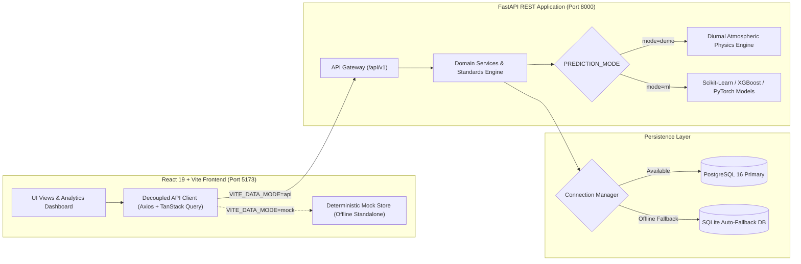

# AQI AI — Environmental Intelligence & Air Quality Prediction Platform

[](https://fastapi.tiangolo.com)
[](https://react.dev)
[](https://www.typescriptlang.org)
[](https://tailwindcss.com)
[](https://www.sqlalchemy.org)
[](https://www.postgresql.org)
[](https://pytest.org)
[](LICENSE)

> **AQI AI** is an environmental intelligence platform that transitions air quality monitoring from reactive observation to proactive numerical forecasting, multi-tier regulatory classification, trajectory velocity modeling, and demographic health risk analysis.

---

## 1. Core Feature Highlights

The platform is designed around four primary environmental intelligence pillars:

1. **AQI Prediction (Regression):** Continuous numerical AQI forecasting across customizable future horizons (1h to 72h), featuring confidence bounds ($\pm 1\sigma$) and physical driving factor attributions.
2. **Air Quality Classification:** Automated categorisation into regulatory health tiers with dual standard support:
   - **US EPA 6-Tier Standard:** Good, Moderate, Unhealthy for Sensitive Groups, Unhealthy, Very Unhealthy, Hazardous.
   - **Indian CPCB NAQI Standard:** Good, Satisfactory, Moderate, Poor, Very Poor, Severe.
3. **Pollution Trend Prediction:** Trajectory velocity modeling determining whether particulate loading is **Increasing ($\nearrow$)**, **Decreasing ($\searr$)**, or **Stable ($\rightarrow$)**, with rate-of-change metrics ($\Delta$ AQI/hr).
4. **Pollution / Health Risk Classification:** Stratified exposure tiers (**Low Risk**, **Moderate Risk**, **High Risk**, **Severe Risk**) with tailored advisories for sensitive demographics (children, elderly, respiratory/cardiac patients).

---

## 2. System Architecture



---

## 3. Technology Stack

### Frontend Client (`frontend/`)
- **Core Framework:** React 19, TypeScript, Vite
- **Styling & Layout:** Tailwind CSS v4, Lucide React icons
- **State & Server Cache:** TanStack Query (React Query)
- **Visualizations:** Recharts (composed timeseries, forecast intervals, bar charts, donut distribution, gauges)
- **Form Management:** React Hook Form + Zod schema validation
- **Routing:** React Router DOM v7

### Backend Application (`backend/`)
- **Language & Server:** Python 3.11+ / 3.13, FastAPI, Uvicorn (ASGI)
- **Validation & Schemas:** Pydantic v2 with strict validation and response metadata
- **ORM & Migrations:** SQLAlchemy 2.x, Alembic
- **Database Engine:** PostgreSQL 16 (psycopg3 driver) with automatic SQLite local development fallback
- **Data & ML Libraries:** pandas, NumPy, scikit-learn, XGBoost
- **Testing:** pytest, pytest-asyncio, HTTPX

---

## 4. Project Directory Structure

```text
aqi-ai/
├── README.md                           # Master system documentation
├── .gitignore                          # Root ignore patterns (Python, Node, DB)
├── docker-compose.yml                  # PostgreSQL and container orchestration
├── .env.example                        # Unified environment configuration
├── aqi_ai.db                           # Local SQLite database (when PostgreSQL is offline)
│
├── frontend/
│   ├── package.json                    # Dependencies & build scripts
│   ├── vite.config.ts                  # Vite build & proxy settings
│   ├── tsconfig.json                   # TypeScript compiler configuration
│   ├── index.html                      # Single page app entrypoint
│   └── src/
│       ├── main.tsx                    # Application bootstrapper
│       ├── app/                        # App root, router, and query client
│       ├── layouts/                    # AppLayout, Sidebar, Topbar, MobileNav
│       ├── pages/                      # 10 Top-level page routes
│       │   ├── OverviewPage.tsx        # High-level KPIs, charts, quick prediction
│       │   ├── AqiPredictionPage.tsx   # Feature 1: Regression modeling
│       │   ├── AirQualityClassificationPage.tsx # Feature 2: Dual-standard classification
│       │   ├── PollutionTrendsPage.tsx # Feature 3: Trajectory velocity
│       │   ├── PollutionRiskPage.tsx   # Feature 4: 4-tier health risk assessment
│       │   ├── AnalyticsPage.tsx       # Statistical profiles & correlations
│       │   ├── ModelPerformancePage.tsx# ML registry & benchmark metrics
│       │   ├── HistoricalDataPage.tsx  # Paginated telemetry table & CSV export
│       │   ├── AboutPage.tsx           # Technical architecture & methodology
│       │   └── NotFoundPage.tsx        # 404 error handler
│       ├── components/                 # Reusable UI widgets, cards, and charts
│       ├── services/                   # Axios API services matching backend routes
│       ├── mocks/                      # Centralized realistic demo datasets
│       ├── lib/                        # EPA/CPCB math, formatters, and utilities
│       └── types/                      # TypeScript schemas mirroring Pydantic models
│
├── backend/
│   ├── requirements.txt                # Python package dependencies
│   ├── pyproject.toml                  # Pytest and linter configuration
│   ├── alembic.ini                     # Migration database settings
│   ├── alembic/versions/               # Database migration revisions
│   ├── app/
│   │   ├── main.py                     # FastAPI application factory & CORS
│   │   ├── core/                       # Config, database engine, logging
│   │   ├── api/v1/                     # Versioned REST API route controllers
│   │   ├── schemas/                    # Pydantic v2 request/response schemas
│   │   ├── models/                     # SQLAlchemy declarative ORM models
│   │   ├── repositories/               # Decoupled database query layer
│   │   ├── services/                   # Business rules & standards calculations
│   │   ├── ml/                         # ML inference, feature builder, loader
│   │   └── data/                       # CSV ingestion script & row validators
│   └── tests/                          # 17 Unit and integration tests
│
└── docs/
    ├── ARCHITECTURE.md                 # System architecture & component hierarchy
    ├── API.md                          # REST API specification & schemas
    ├── DATASET.md                      # Dataset dictionary & ingestion instructions
    └── ML_INTEGRATION.md               # Model training & drop-in instructions
```

---

## 5. Quick Start & Installation

### Prerequisites
- **Node.js:** v18.0.0+ (v20+ recommended)
- **Python:** v3.11+ (Python 3.11 - 3.13 tested)
- **Git**
- *(Optional)* **Docker & Docker Compose** for running PostgreSQL in a container

---

### Step 1: Environment Setup

Clone or open the repository, then copy the environment template:
```bash
# In the project root:
cp .env.example .env
```

---

### Step 2: Backend Setup

1. Open a PowerShell or Bash terminal in the `backend/` directory:
   ```bash
   cd backend
   ```

2. Create and activate a Python virtual environment:
   ```powershell
   # Windows PowerShell:
   python -m venv venv
   .\venv\Scripts\Activate.ps1
   ```

3. Install backend dependencies:
   ```bash
   pip install -r requirements.txt
   ```

4. Run database migrations:
   ```bash
   # Executes Alembic migrations (creates PostgreSQL tables or local SQLite tables)
   alembic upgrade head
   ```

5. Start the FastAPI development server:
   ```bash
   python -m uvicorn app.main:app --reload --port 8000
   ```
   The backend API will be live at `http://localhost:8000`.  
   Interactive Swagger documentation is available at `http://localhost:8000/docs`.

---

### Step 3: Frontend Setup

1. Open a new terminal in the `frontend/` directory:
   ```bash
   cd frontend
   ```

2. Install Node dependencies:
   ```bash
   npm install
   ```

3. Start the Vite development server:
   ```bash
   npm run dev
   ```
   Open `http://localhost:5173` in your browser.

---

### Step 4: (Optional) Running with Docker Compose

To launch PostgreSQL, FastAPI, and the React frontend with a single command:
```bash
docker compose up --build
```
- Frontend: `http://localhost:3000`
- Backend: `http://localhost:8000`
- PostgreSQL: `localhost:5432`

---

## 6. Testing & Validation

The backend includes a comprehensive pytest suite verifying health endpoints, prediction physics, classification boundaries, trend velocity, risk tiers, and CSV validation:

```bash
cd backend
python -m pytest tests/ -v
```

Output:
```text
tests/test_classification.py::test_classify_epa_categories PASSED
tests/test_classification.py::test_classify_cpcb_categories PASSED
tests/test_csv_validation.py::test_valid_row PASSED
tests/test_csv_validation.py::test_missing_required_fields PASSED
tests/test_csv_validation.py::test_negative_values_rejected PASSED
tests/test_csv_validation.py::test_invalid_date_format PASSED
tests/test_csv_validation.py::test_outlier_warning PASSED
tests/test_health.py::test_health_endpoint PASSED
tests/test_health.py::test_database_health_endpoint PASSED
tests/test_health.py::test_root_endpoint PASSED
tests/test_predictions.py::test_valid_automatic_prediction PASSED
tests/test_predictions.py::test_valid_advanced_prediction PASSED
tests/test_predictions.py::test_prediction_horizon_bounds PASSED
tests/test_predictions.py::test_negative_pollutant_validation PASSED
tests/test_risks.py::test_risk_assessment_tiers PASSED
tests/test_trends.py::test_get_trends_endpoint PASSED
tests/test_trends.py::test_forecast_trend_post PASSED

======================= 17 passed in 0.24s =======================
```

To test the frontend production build and TypeScript compilation:
```bash
cd frontend
npm run build
```

---

## 7. Importing Historical Data

The platform includes an automated ingestion tool for importing real historical measurements (e.g., CPCB India or US EPA records):

```bash
cd backend
python app/data/import_historical_data.py --csv path/to/delhi_aqi.csv --city "Delhi" --batch-size 1000
```
For detailed schema requirements, column mappings, and data cleaning guidelines, see [`docs/DATASET.md`](docs/DATASET.md).

---

## 8. Transitioning to Real ML Models (Phase 2)

The application is architected so that machine learning models can be dropped in without altering the frontend or database schemas:

1. Train your regression/classification estimators (Random Forest, XGBoost, LightGBM, or PyTorch LSTM) on historical features.
2. Export the bundle into `backend/app/ml/models/aqi_regressor.joblib`.
3. Set `PREDICTION_MODE=ml` in `.env`.
4. Restart FastAPI. `ModelLoader` will dynamically load the weights and route live inference.

Refer to [`docs/ML_INTEGRATION.md`](docs/ML_INTEGRATION.md) for feature order specifications, sample training code, and zero-downtime fallback configuration.

---

## 9. RAG Environmental Assistant Roadmap (Phase 3)

In Phase 3, an intelligent conversational copilot will be integrated into the navigation bar:
- **Knowledge Base:** Central Pollution Control Board (CPCB) advisories, WHO Air Quality Guidelines (2021), and medical pulmonary guidelines.
- **Vector Store:** PostgreSQL `pgvector` or ChromaDB storing semantic embeddings.
- **RAG Engine:** LangChain/LlamaIndex pipeline providing source-grounded answers with verifiable citations.
- **Academic Integrity:** *Phase 1 intentionally excludes simulated chat endpoints to ensure all deliverable features are strictly functional and rigorous.*

---

## 10. Technical Documentation Index

- [System Architecture & Component Diagram](docs/ARCHITECTURE.md)
- [REST API Reference & Endpoints](docs/API.md)
- [Historical Dataset Schema & Ingestion](docs/DATASET.md)
- [Machine Learning Integration Guide](docs/ML_INTEGRATION.md)

---

## 11. License & Disclaimer
This project is licensed under the MIT License. Developed for environmental intelligence research and technical evaluation. All simulated predictions and data badges are clearly marked in Phase 1 for complete academic transparency.
