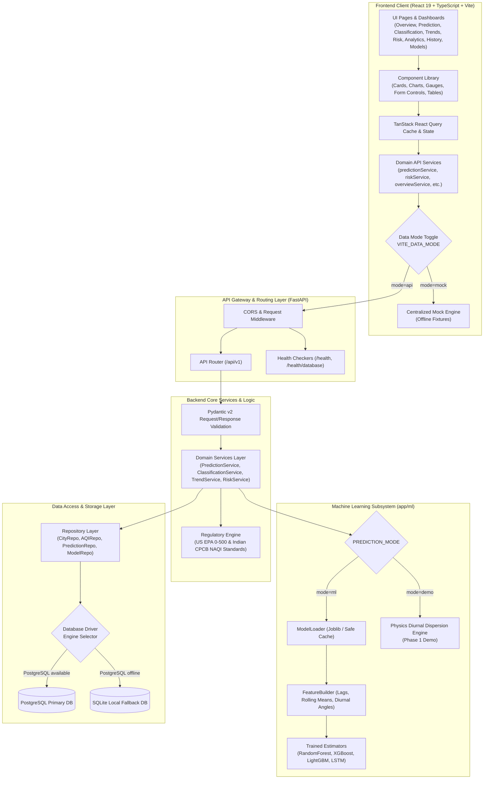

# AQI AI — System Architecture & Design Documentation

## 1. System Overview

**AQI AI** is an environmental intelligence platform engineered to transition air quality monitoring from passive observation to proactive numerical forecasting, multi-tier regulatory classification, trajectory velocity modeling, and demographic health risk analysis.

The system is constructed with a decoupled, contract-first full-stack architecture:
- **Frontend Presentation Layer:** Built with React 19, Vite, TypeScript, and Tailwind CSS.
- **Backend Application Layer:** Powered by Python FastAPI, Pydantic v2 schemas, and SQLAlchemy 2.x.
- **Persistence & Storage Layer:** Production PostgreSQL with seamless SQLite local development fallback.
- **Inference & Preprocessing Layer:** Modular Python inference engine supporting simulated atmospheric dispersion in Phase 1 and drop-in scikit-learn / XGBoost / PyTorch models in Phase 2.

---

## 2. End-to-End Architectural Diagram

---

## 3. Data Flow Specification

1. **User Interaction & Request Formulation:**
   - A user interacts with an input form (e.g., selecting forecast horizon on `AqiPredictionPage` or filtering historical measurements on `HistoricalDataPage`).
   - The view layer invokes a TanStack Query hook, which routes through `src/services/predictionService.ts`.

2. **Client-Side Mode Resolution:**
   - `apiClient.ts` inspects the `VITE_DATA_MODE` environment variable.
   - If set to `api`, it transmits an asynchronous HTTP request with Axios to the FastAPI backend at `http://localhost:8000/api/v1/aqi/predict`.
   - If set to `mock` or if the backend is unreachable during local evaluation, it immediately returns deterministic, structured responses from `src/mocks/predictions.ts`.

3. **Backend Ingestion & Validation:**
   - FastAPI intercepts the request, executing CORS headers verification and Pydantic validation via `PredictionRequest`.
   - If inputs violate physical constraints (e.g., negative particulate concentrations or invalid horizon bounds), Pydantic returns HTTP 422 with actionable validation errors.

4. **Domain Execution & Atmospheric Physics:**
   - The route handler delegates to `PredictionService.predict_aqi(...)`.
   - The service resolves the active `PREDICTION_MODE`. In Phase 1, `inference.predict_aqi()` computes diurnal atmospheric dynamics, peak-hour rush factor curves, and weather modulators (wind speed dilution, relative humidity stagnation).
   - In Phase 2 (`PREDICTION_MODE=ml`), `ModelLoader` loads serialized estimators, `FeatureBuilder` extracts temporal lags and rolling statistics, and model inferences are returned.

5. **Regulatory Standard Computation:**
   - Both **US EPA** (6 tiers) and **Indian CPCB NAQI** break-point formulas are evaluated in `app/services/standards.py`.
   - The dominant pollutant determining the composite index is identified.

6. **Envelope Construction & Metadata Attribution:**
   - Responses are encapsulated with `ApiResponseMetadata`, containing `timestamp`, `is_demo: true`, `model_version: "v1.0.0-demo"`, and execution context.
   - Every response sent to the frontend clearly labels simulated data to preserve academic and production integrity.

---

## 4. Layered Directory & Module Responsibilities

### 4.1 Frontend Architecture (`frontend/src/`)
| Directory | Responsibility | Key Files |
| :--- | :--- | :--- |
| `app/` | Global configuration, routing registry, and query client setup | `App.tsx`, `router.tsx`, `query-client.ts` |
| `layouts/` | Shell frame, responsive sidebar, top navigation, and demo notice | `AppLayout.tsx`, `Sidebar.tsx`, `Topbar.tsx`, `MobileNavigation.tsx` |
| `pages/` | Top-level routed views for all 10 platform destinations | `OverviewPage.tsx`, `AqiPredictionPage.tsx`, `AirQualityClassificationPage.tsx`, etc. |
| `components/` | Modular UI elements, charts, gauges, tables, and dialogs | `AQIGauge.tsx`, `OverviewCharts.tsx`, `PredictionResultCard.tsx`, etc. |
| `services/` | Decoupled Axios HTTP client and domain-specific endpoint callers | `apiClient.ts`, `endpoints.ts`, `predictionService.ts`, etc. |
| `mocks/` | Deterministic, realistic mock datasets for standalone execution | `overview.ts`, `predictions.ts`, `trends.ts`, `risk.ts`, etc. |
| `lib/` | Pure mathematical formulas, EPA/CPCB color maps, and date formatters | `aqi.ts`, `formatters.ts`, `utils.ts` |
| `types/` | Strict TypeScript interface definitions mirroring backend schemas | `index.ts` |

### 4.2 Backend Architecture (`backend/app/`)
| Directory | Responsibility | Key Files |
| :--- | :--- | :--- |
| `core/` | Global settings, database connection manager, logging, exceptions | `config.py`, `database.py`, `logging.py`, `exceptions.py` |
| `api/v1/` | Versioned REST endpoint controllers mapping routes to services | `predictions.py`, `classification.py`, `trends.py`, `risks.py`, etc. |
| `schemas/` | Pydantic validation schemas with explicit types, bounds, examples | `prediction.py`, `classification.py`, `trend.py`, `risk.py`, etc. |
| `services/` | Business rules, EPA/CPCB standards calculations, analytics | `prediction_service.py`, `standards.py`, `risk_service.py`, etc. |
| `repositories/`| Clean data access layer isolating SQLAlchemy ORM queries | `aqi_repository.py`, `city_repository.py`, `prediction_repository.py` |
| `models/` | SQLAlchemy 2.x declarative table definitions | `city.py`, `historical_aqi.py`, `pollutant_record.py`, etc. |
| `ml/` | Model loaders, feature builders, preprocessing, and inference wrappers | `model_loader.py`, `inference.py`, `feature_builder.py`, `preprocessing.py` |
| `data/` | Historical CSV ingestion engine, row validators, and batch upserts | `import_historical_data.py`, `validators.py` |

---

## 5. Dual Regulatory Standards Support

Air Quality Index calculations differ significantly between jurisdictions. AQI AI implements explicit support for both primary frameworks:

### US EPA Standard (6 Categories)
- **Good (0–50):** Air quality is satisfactory; air pollution poses little or no risk.
- **Moderate (51–100):** Air quality is acceptable; potential concern for a very small number of unusually sensitive individuals.
- **Unhealthy for Sensitive Groups (101–150):** Members of sensitive groups may experience health effects.
- **Unhealthy (151–200):** Everyone may begin to experience health effects; sensitive groups experience more serious effects.
- **Very Unhealthy (201–300):** Health alert: the risk of health effects is increased for everyone.
- **Hazardous (301–500):** Health warning of emergency conditions: the entire population is more likely to be affected.

### Indian CPCB NAQI Standard (6 Categories)
- **Good (0–50):** Minimal impact.
- **Satisfactory (51–100):** Minor breathing discomfort to sensitive people.
- **Moderate (101–200):** Breathing discomfort to people with lungs, asthma, and heart diseases.
- **Poor (201–300):** Breathing discomfort to most people on prolonged exposure.
- **Very Poor (301–400):** Respiratory illness on prolonged exposure.
- **Severe (401–500):** Affects healthy people and seriously impacts those with existing diseases.

Both standards are computed via piecewise linear interpolation based on pollutant sub-indices:
$$I = \frac{I_{hi} - I_{lo}}{BP_{hi} - BP_{lo}} (C - BP_{lo}) + I_{lo}$$

---

## 6. Resilience & Database Fallback Architecture

To ensure zero developer friction and reliable testing, `backend/app/core/database.py` employs a robust connection strategy:
1. When starting, the application attempts to initialize the connection pool using `DATABASE_URL` (PostgreSQL).
2. If the PostgreSQL server is offline or credentials fail, the application catches the `OperationalError`, emits a structured warning log, and automatically provisions an isolated SQLite database at `SQLITE_FALLBACK_URL` (`sqlite:///./aqi_ai.db`).
3. This guarantees that `pytest` test suites, CLI scripts, and developer workstations can run instantly without requiring a live Docker daemon.

---

## 7. Migration Roadmap

- **Phase 1 (Complete):** Responsive React dashboard, FastAPI REST API, dual-standard regulatory engine, synthetic diurnal dispersion simulation, CSV ingestion script, and test suite.
- **Phase 2 (ML Model Training):** Replace synthetic inference with trained Random Forest, XGBoost, and PyTorch LSTM models using `docs/ML_INTEGRATION.md`.
- **Phase 3 (RAG Environmental Assistant):** Connect LangChain / LlamaIndex vector retrieval over CPCB and WHO scientific documents to power source-grounded environmental question-answering.
